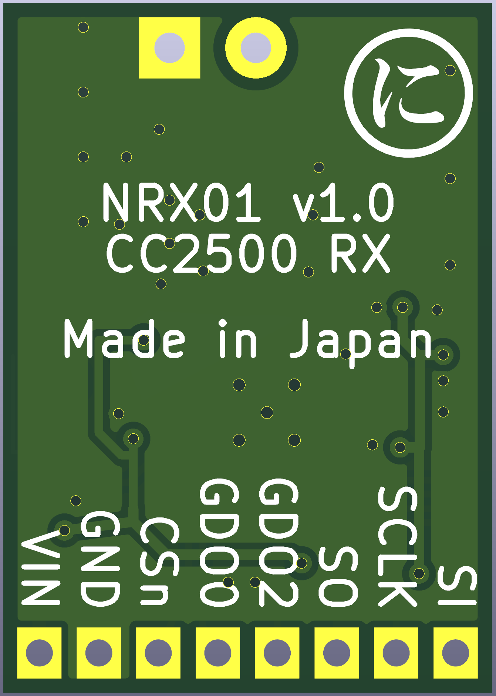
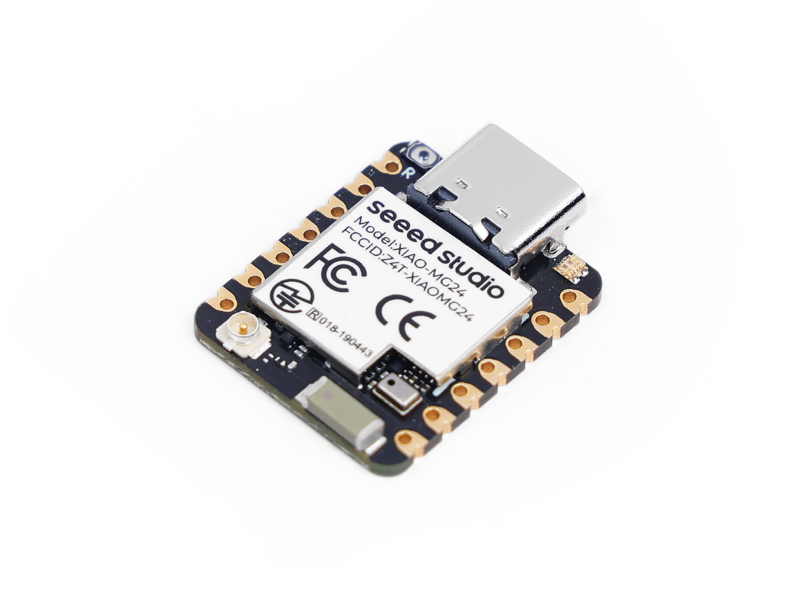

# NRX01 S-FHSS 受信機

TI CC2500 を使った小さな 2.4 GHz 受信基板 **NRX01** と、Seeed Studio XIAO MG24 Sense を組み合わせた
Futaba S-FHSS 受信機です。

**[説明ページ](https://westisland.jp/Receiver/)** ・ **[Receiver ソフトを開く](https://westisland.jp/Receiver/app.html)** ・ **[仕様書](docs/SPEC.md)**

| NRX01 表面 | NRX01 裏面 | XIAO MG24 Sense（ホスト） |
|:---:|:---:|:---:|
|  |  |  |
| 14.38 × 20.27 mm、CC2500 と RF 部品 | ピン名表示、裏面は GND ベタ | 写真：Seeed Studio |

## 特長

- **受信のみ**：技適のない無線部（CC2500）からは電波を出さない設計です。
- **S.BUS 16 ch**（標準の反転信号、変換回路不要）と **PWM 6 ch** を同時に出力します。
- **ブラックボックス**：XIAO の 4 MB フラッシュに 100 Hz で記録します。Betaflight / Rotorflight 互換の .bbl 形式で、受信値・受信強度・ジャイロ・加速度を残します。
- **フライトシミュレーター**：Bluetooth ゲームパッドとしてパソコンにつながり、S-FHSS の送信機でシミュレーターを操縦できます（追加ソフト不要）。
- **バインド**：USB シリアルの `bind` コマンド、または Receiver ソフトのボタンで行います。
- 無線部は TI の CC2500EM 参照設計（0.8 mm 基板版）をそのまま写しています。

## 今後の予定

XIAO MG24 Sense に載っている 6 軸センサー（ジャイロ・加速度）を使って、ジャイロ機能を順に追加する予定です。

1. **バギー**：走行中の向きのぶれをステアリングで補正し、まっすぐ走りやすくします。
2. **飛行機**：エルロン・エレベーター・ラダーで機体の揺れを抑え、姿勢を安定させます。
3. **ヘリコプター**（最終目標）：ヘリコプター用のジャイロ機能を目指します。

> 個人が趣味で開発している物なので、予定は変わることがあります。

## 主な仕様

| 項目 | 内容 |
|---|---|
| 対応方式 | Futaba S-FHSS（2.4 GHz、30 ch 周波数ホッピング） |
| 出力 | S.BUS 16 ch（D6）、PWM 6 ch（D3 / D4 / D5 / D7 / D18 / D0） |
| Bluetooth | ゲームパッド（8 軸＋8 ボタン）とコマンド。電源投入後 60 秒間だけ受付、接続がなければ停止 |
| 記録 | 100 Hz、4 MB で約 28 分 |
| NRX01 基板 | 14.38 × 20.27 mm、2 層 0.8 mm、J1 8 ピン（1.75 mm ピッチ）、アンテナ・GND 端子 |
| 電源 | 3.3 V（XIAO の 3V3 から） |

詳しくは [仕様書](docs/SPEC.md) を見てください。

## Receiver ソフト

ブラウザから XIAO MG24 に USB ケーブルか Bluetooth でつなぎ、ログの保存・バインド・情報表示・記録停止・全消去ができます。
Chrome / Edge で使えます（Bluetooth は Android のスマートフォンからも可。iPhone は非対応）。インストールは不要です。

→ **[Receiver ソフトを開く](https://westisland.jp/Receiver/app.html)**

## 状態

基板データとファームウェアは作成済みです。基板は試作の準備中で、実機での動作確認はまだです。

## クレジット

- S-FHSS 受信処理は [opiopan/rcstick-f](https://github.com/opiopan/rcstick-f)（Apache License 2.0）を移植・改変したものです。
- XIAO MG24 Sense の写真は Seeed Studio によるものです。
- 無線部の回路・配置は TI の CC2500EM 参照設計に基づきます。

---

[にしやん工房](https://westisland.jp/)
