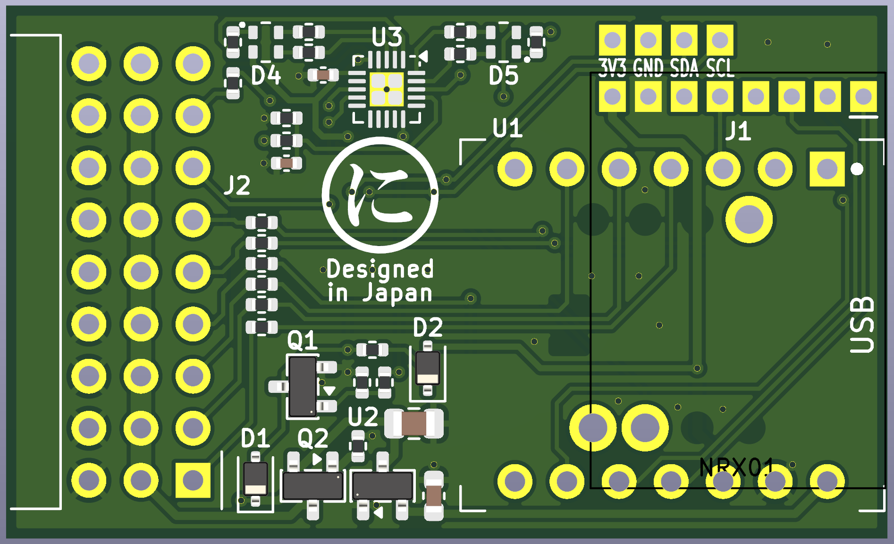
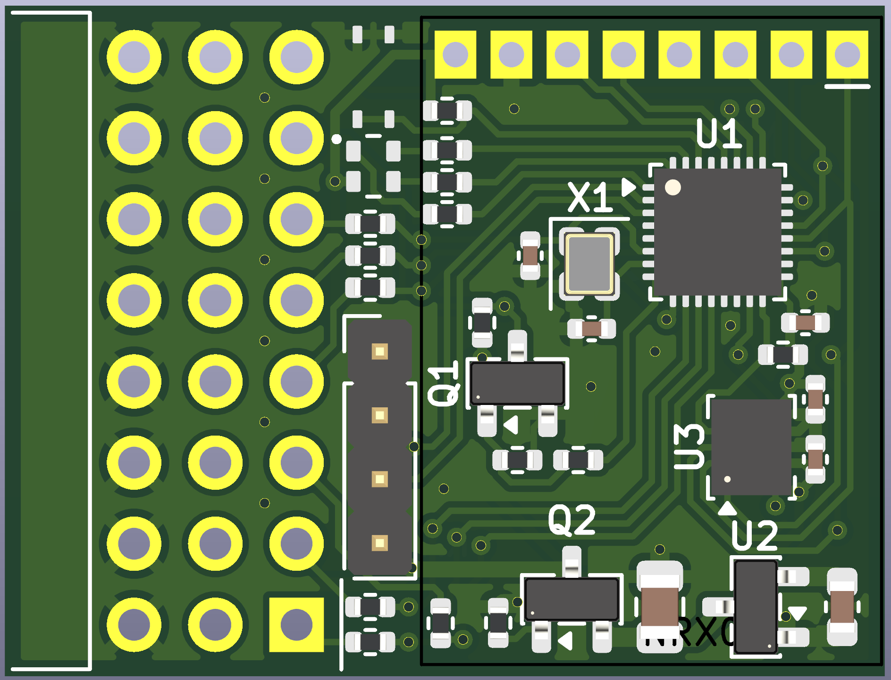

# S-FHSS 受信機 NRX01 / NRX02 / NRX03

TI CC2500 を使った小さな 2.4 GHz 受信モジュール **NRX01** と、それを使った Futaba S-FHSS 受信機です。
どれも受信のみで、技適のない無線部（CC2500）からは電波を出さない設計です。

| | 内容 | 説明ページ |
|---|---|---|
| **NRX01** S-FHSS SPI制御受信モジュール | CC2500 の無線部だけのモジュール。14.38 × 20.27 mm、SPI で制御 | [NRX01](https://westisland.jp/Receiver/) |
| **NRX02** XIAO MG24 Sense 全部入り受信機 | NRX01 と XIAO MG24 Sense を 1 枚に。S.BUS・PWM 6 ch、ブラックボックス、Bluetooth | [NRX02](https://westisland.jp/Receiver/nrx02.html) |
| **NRX03** S-FHSS 小型ジャイロ受信機 | NRX01 を重ねる 27.5 × 21 mm。CH32V006 と 6 軸センサー、S.BUS・PWM 6 ch | [NRX03](https://westisland.jp/Receiver/nrx03.html) |

**[Receiver ソフトを開く](https://westisland.jp/Receiver/app.html)**（NRX02 用：ログ取り出し・バインド） ・ **[仕様書](docs/SPEC.md)**（NRX01 と XIAO MG24 Sense の受信機）

| NRX01 表面 | NRX02 表面（基板の図） | NRX03 表面（基板の図） |
|:---:|:---:|:---:|
|  |  |  |
| 14.38 × 20.27 mm | 43 × 26 mm | 27.5 × 21 mm |

## 状態

- NRX01：基板データは作成済み。基板は試作の準備中で、実機での動作確認はまだです。
- NRX02：基板データは作成済みで、試作基板を準備中です。ファームウェアは NRX01 と XIAO MG24 Sense を配線でつないだ形で作成済み（実機での動作確認はまだ）。
- NRX03：基板データを作成中です。ファームウェアはこれからです。

> 個人が趣味で開発している物なので、予定は変わることがあります。

## クレジット

- S-FHSS 受信処理は [opiopan/rcstick-f](https://github.com/opiopan/rcstick-f)（Apache License 2.0）を移植・改変したものです。
- XIAO MG24 Sense の写真は Seeed Studio によるものです。
- 無線部の回路・配置は TI の CC2500EM 参照設計に基づきます。

---

[にしやん工房](https://westisland.jp/)
