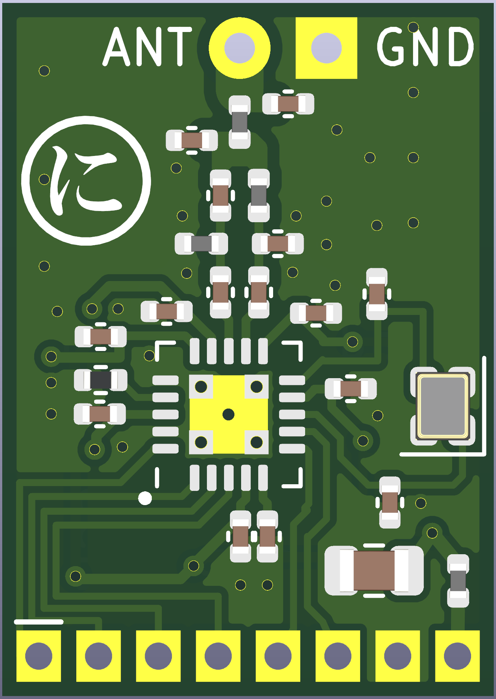

# Receiver — NRX01 S-FHSS 受信機

TI CC2500 を使った小型 2.4 GHz 受信基板 **NRX01** と、Seeed Studio XIAO MG24 Sense を組み合わせた
Futaba S-FHSS 受信機です。

- 受信のみ（技適のない無線部から電波を出さない設計）
- 出力：S.BUS 16 ch ＋ PWM 6 ch
- ブラックボックス：100 Hz、Betaflight / Rotorflight 互換の .bbl

## ドキュメント
- [仕様書](docs/SPEC.md)
- [説明ページ](https://westisland.jp/Receiver/)
- [Receiver ソフト（ログ取り出し・バインド）](https://westisland.jp/Receiver/app.html) — Chrome / Edge、Web Serial

> 状態：基板データとファームウェアは作成済み。実機での動作確認はまだです。
