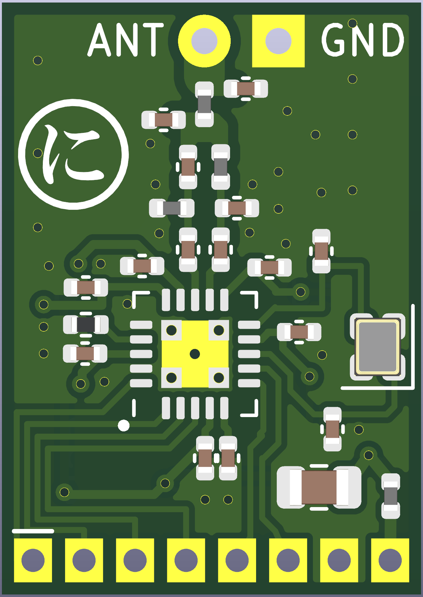
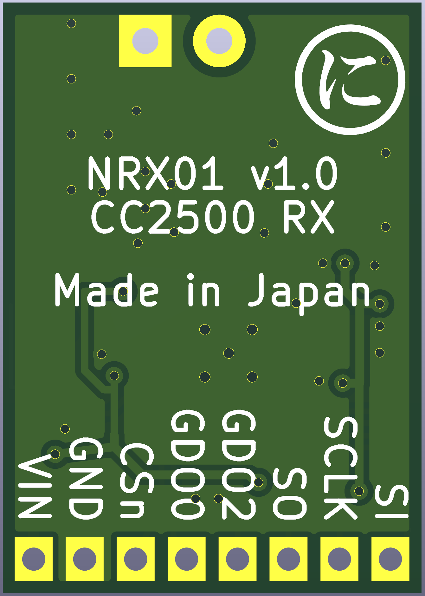
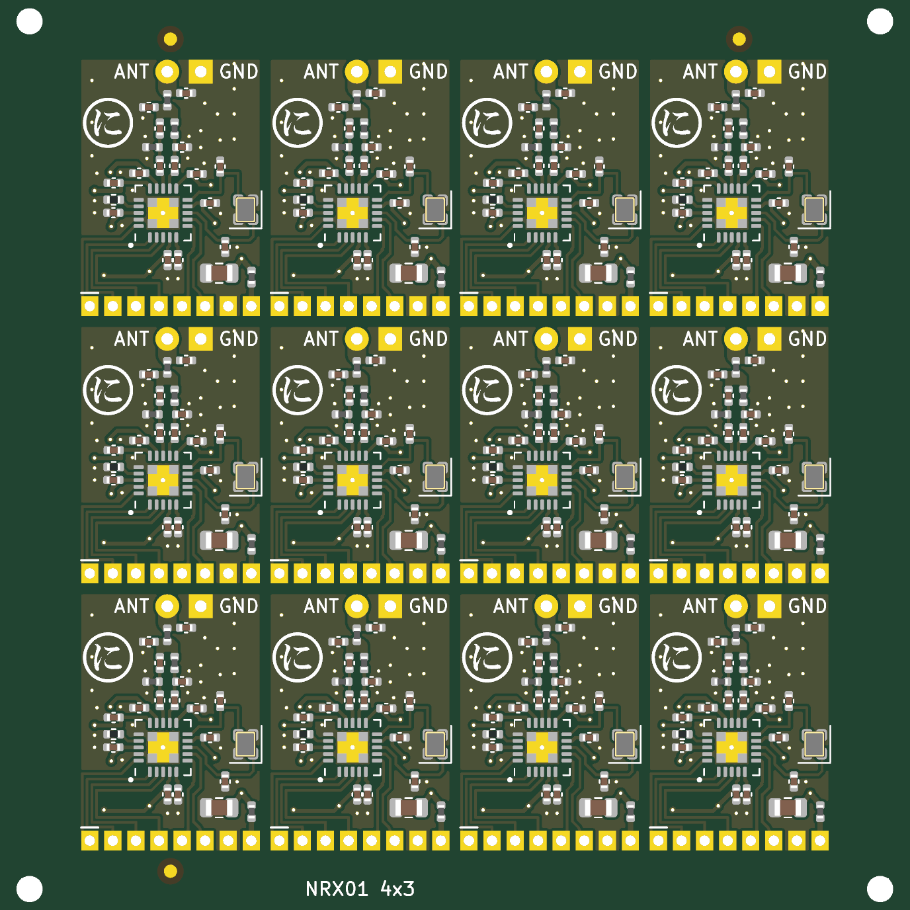
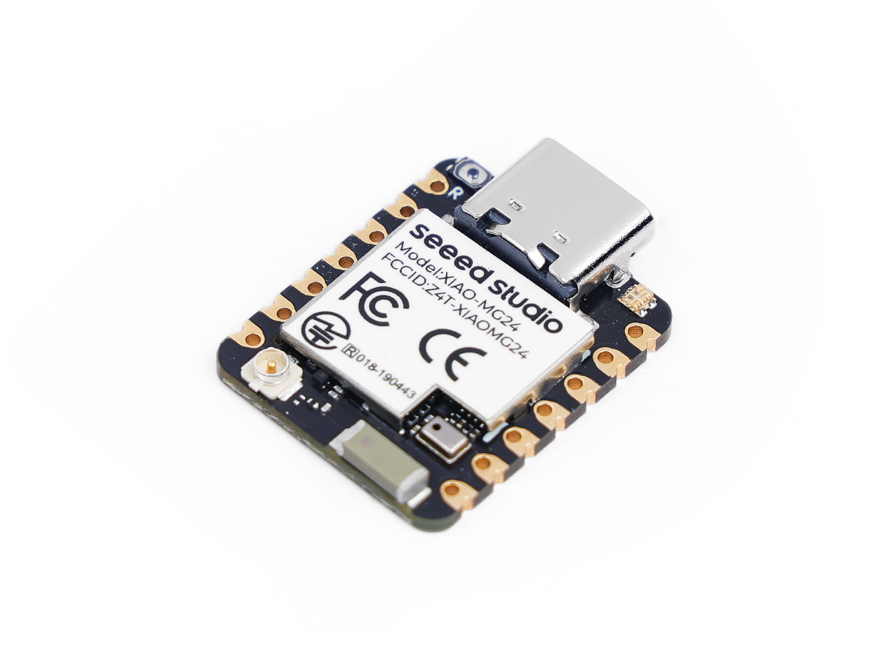

# NRX01 S-FHSS 受信機 仕様書

| 項目 | 内容 |
|---|---|
| 名称 | NRX01（CC2500 2.4 GHz 受信基板）＋ Seeed Studio XIAO MG24 Sense |
| 基板版数 | v1.0（2026-11-21） |
| ファームウェア | NRX01 S-FHSS RX 1.0 |
| 対応方式 | Futaba S-FHSS（受信のみ） |
| 出力 | S.BUS 16 ch、PWM 6 ch |
| 記録 | ブラックボックス 100 Hz（Betaflight / Rotorflight 互換 .bbl） |

> **状態**：基板データ・ファームウェアともに作成済み。ファームウェアはコンパイルまで確認済みで、**実機での動作確認はまだ**です。

---

## 1. 構成

```
 アンテナ線(λ/4) ── NRX01 ──── SPI / GDO0 ────┐
                    (CC2500)                   │
                                     Seeed XIAO MG24 Sense
                                     (EFR32MG24, IMU, 4 MB フラッシュ)
                                               │
                         ┌─────────────────────┼──────────────────────┐
                    S.BUS (D6)          PWM 6 ch (D0,D3,D4,D5,D7,D18)   USB（設定・ログ取り出し）
```

- 無線部は TI CC2500 の参照設計（CC2500EM rev3.0、0.8 mm 基板版）をそのまま写した 2 層基板です。
- 受信処理・出力・記録は XIAO MG24 側のファームウェアで行います。

---

## 2. NRX01 基板

| 表面 | 裏面（裏から見た向き） |
|---|---|
|  |  |

### 2.1 基板仕様
| 項目 | 内容 |
|---|---|
| 外形 | 14.38 × 20.27 mm |
| 層数・板厚 | 2 層、0.8 mm（FR-4） |
| 無線部 | TI CC2500EM rev3.0（0.8 mm 版）の配置・配線を 1:1 で使用。裏面は GND ベタ |
| 銅箔と基板端 | 0.4 mm 以上（V カット面付けに対応） |
| シルク | 文字 1.0 mm／線幅 0.15 mm 以上（JLCPCB 推奨値） |
| 製造ルール | JLCPCB 標準ルールで製造可能（DRC 確認済み） |

### 2.2 端子
**J1：ホスト接続（スルーホールのはんだパッド 8 個、1.75 mm ピッチ、穴 0.8 mm）**

| ピン | 信号 | 内容 | XIAO MG24 |
|---|---|---|---|
| 1 | SI | SPI データ入力（MOSI） | D10 |
| 2 | SCLK | SPI クロック | D8 |
| 3 | SO | SPI データ出力（MISO） | D9 |
| 4 | GDO2 | 汎用出力（ファームウェアでは未使用・ハイインピーダンス） | 接続不要 |
| 5 | GDO0 | 受信割込み（CRC 正常のパケット受信で High） | D2 |
| 6 | CSn | チップセレクト | D1 |
| 7 | GND | グラウンド | GND |
| 8 | VIN | 電源 3.3 V | 3V3 |

**J2：アンテナ（ANT と GND、2.54 mm ピッチ、穴 0.9 mm）**
- ANT に λ/4（約 30 mm）の単線を基板から垂直に立てます。
- 隣の GND パッドは、同軸ピグテールのシールドなどに使えます。

### 2.3 電気的仕様
| 項目 | 内容 |
|---|---|
| 電源電圧 | 3.3 V（CC2500 の動作範囲 1.8〜3.6 V） |
| 消費電流 | 受信時 約 20 mA（CC2500 のデータシート値） |
| 電源フィルタ | フェライトビーズ（1 kΩ@100 MHz）＋ 10 µF ＋ 各電源ピン直近のデカップリング |
| 基準発振 | 26 MHz 水晶、負荷容量 9 pF、±10 ppm |

### 2.4 部品表（1 枚あたり）
| 記号 | 部品 | 値 | サイズ | 数 | LCSC |
|---|---|---|---|---|---|
| U1 | CC2500RGPR | 2.4 GHz トランシーバ | QFN-20 4×4 mm | 1 | C57494 |
| X1 | 水晶 | 26 MHz・CL 9 pF・±10 ppm（YXC X201626MLB4SI） | 2016 | 1 | C5210657 |
| L121, L122, L131 | 積層インダクタ（RF 用） | 1.2 nH | 0402 | 3 | C77105 |
| L1 | フェライトビーズ | BLM15HG102（1 kΩ@100 MHz） | 0402 | 1 | C76889 |
| R171 | 抵抗 | 56 kΩ ±1% | 0402 | 1 | C25796 |
| C41, C51, C111, C141 | コンデンサ | 100 nF X7R | 0402 | 4 | C1525 |
| C91, C151, C181 | コンデンサ | 220 pF C0G | 0402 | 3 | C39122 |
| C121, C131 | コンデンサ | 100 pF C0G | 0402 | 2 | C1546 |
| C81, C101 | コンデンサ | 10 pF C0G（水晶の負荷） | 0402 | 2 | C32949 |
| C122, C132 | コンデンサ | 1 pF C0G | 0402 | 2 | C1550 |
| C123 | コンデンサ | 1.8 pF C0G | 0402 | 1 | C1553 |
| C124 | コンデンサ | 1.5 pF C0G | 0402 | 1 | C1552 |
| C1 | コンデンサ | 10 µF 25 V X5R | 0805 | 1 | C15850 |
| J1, J2 | はんだパッド | — | — | — | （部品なし） |

- RF 部と水晶の負荷用コンデンサは C0G（NP0）を使います。
- R171 は CC2500 の基準電流を決めるため ±1% 品を使います。

### 2.5 面付け（JLCPCB 実装用）


| 項目 | 内容 |
|---|---|
| 配置 | 4 列 × 3 段 = 12 個、隙間なし |
| 外形 | 70.5 × 70.8 mm（V カット・標準実装の最小 70 × 70 mm を満たす） |
| 分割 | V カット（端から端まで直線、外形層に「V-CUT」表記） |
| 捨て基板 | 上下 5 mm、左右 6.5 mm |
| 基準マーク | 1 mm（レジスト開口 2 mm）× 3、パネル端から 3.85 mm、非対称 |
| 治具穴 | 2 mm × 4（四隅） |

---

## 3. XIAO MG24 Sense のピン割り当て



（写真：Seeed Studio）

| 用途 | ピン |
|---|---|
| CC2500 SPI（SCK / MISO / MOSI） | D8 / D9 / D10 |
| CC2500 CSn / GDO0 | D1 / D2 |
| S.BUS 出力 | D6 |
| PWM 出力 CH1〜CH6 | D3 / D4 / D5 / D7 / D18（裏面パッド） / D0 |
| ブラックボックス用フラッシュ（基板上） | D15 / D16 / D17 ＋ 内部 PA6 |
| IMU（基板上 LSM6DS3TR-C） | D13 / D14（内部配線） |
| USB シリアル | D11 / D12（内部配線） |

> ブラックボックスを無効（`BLACKBOX = false`）にすると、PWM は CH1〜CH8 を D3 / D4 / D5 / D7 / D15 / D16 / D17 / D18 に出します。

---

## 4. 無線（S-FHSS 受信）

| 項目 | 内容 |
|---|---|
| 周波数 | 2.4 GHz 帯、30 チャンネル（約 1.5 MHz 間隔）の周波数ホッピング |
| 変調・速度 | 2-FSK、約 128 kbps |
| パケット | 15 バイト（送信機 ID 16 bit、ホッピング符号、4 ch 分のデータ）を 2 つで 8 ch |
| パケット間隔 | 約 6.8 ms |
| 誤り検出 | CRC（不正なパケットは捨てる） |
| チャンネル数 | 8 ch（パルス幅 µs、中央 1520 µs） |
| 起動時の校正 | 30 チャンネル分の周波数校正値を測って保存し、ホッピング時に再利用 |
| 送信 | **しない**（下の「法令について」参照） |

### 4.1 バインド
- **初回**：送信機 ID を記憶していなければ、最初に受信した S-FHSS 送信機に自動でバインドし、ID を保存します。
- **やり直し**：USB シリアルで `bind` を送るか、Web アプリの「バインド」ボタンを押します。その場で新しい送信機を探します。
- 送信機はモデル設定で S-FHSS にして電源を入れ、近くに他の S-FHSS 送信機がない状態で行います。
- 記憶した ID 以外の送信機のパケットは無視します。
- 電源投入のたびに、送信機のタイミングに同期するため 3〜4 秒かかります（ID は覚え直しません）。

### 4.2 フェイルセーフ
| 条件 | 動作 |
|---|---|
| 30 ms 以上パケットなし | S.BUS の「フレーム欠落」フラグを立てる |
| 1 秒以上正しいパケットなし | フェイルセーフ：CH3（スロットル）を 1100 µs、他は最後の値を保持（設定で変更可）。S.BUS のフェイルセーフフラグを立てる |
| 30 回続けて受信できない | チャンネル 0 に戻って再同期（送信機 ID は保持） |

---

## 5. 出力

### 5.1 S.BUS
| 項目 | 内容 |
|---|---|
| ピン | D6（＋ GND） |
| 形式 | 100000 baud、8 ビット、偶数パリティ、ストップビット 2、反転（標準 S.BUS、変換回路不要） |
| 周期 | 14 ms |
| チャンネル | 16 ch（CH1〜8 に受信値、CH9〜16 は中央） |
| 値 | 0〜2047（1520 µs = 1024、0.625 µs / 1） |
| 送り始め | 送信機と一度つながってから |

### 5.2 PWM
| 項目 | 内容 |
|---|---|
| チャンネル | 6 ch（D3, D4, D5, D7, D18, D0） |
| 周期・分解能 | 50 Hz（20 ms）、1 µs |
| 範囲 | 800〜2200 µs |
| 方式 | TIMER1 の比較割込みで 1 本ずつ順番にパルスを出す（どのピンでも出せる） |
| 送り始め | 送信機と一度つながってから |

サーボの電源は XIAO の 3V3 からは取らず、別電源（受信機用バッテリーや BEC）から供給し、GND を共通にしてください。

---

## 6. ブラックボックス（飛行ログ）

| 項目 | 内容 |
|---|---|
| 記録先 | XIAO MG24 基板上の 4 MB SPI フラッシュ |
| 周期 | 100 Hz |
| 形式 | Cleanflight / Betaflight ブラックボックス形式（Data version 2）。I フレーム 32 回に 1 回、間は P フレーム（差分） |
| 対応ソフト | Betaflight Blackbox Explorer、Rotorflight Blackbox、blackbox_decode |
| データ量 | 1 フレーム約 25 バイト → 4 MB で約 28 分 |
| 開始・終了 | 電源投入後、送信機と初めてつながったときに新しいログを開始。電源断または `stop` まで |
| 複数ログ | フラッシュに追記（各ログは新しいページから） |
| 書き込み | RAM のリングバッファ（16 KB）から 256 バイトずつ非同期に書き込み（受信処理を止めない） |
| 消去 | 飛行中は行わない。満杯になったら地上で全消去 |

### 6.1 記録項目
| フィールド | 内容 |
|---|---|
| loopIteration, time | フレーム番号、時刻（µs） |
| rcCommand[0..3] | ロール・ピッチ・ヨー（µs − 1520）、スロットル（µs）。Futaba の CH1 / CH2 / CH4 / CH3 |
| rxCh[0..7] | CH1〜CH8 の出力パルス幅（µs、フェイルセーフ反映後） |
| rssi | 受信強度（−100〜−30 dBm を 0〜1023 に換算） |
| rxLost | 取りこぼしたパケット数（累計） |
| rxFailsafe | フェイルセーフ中なら 1 |
| gyroADC[0..2] | ジャイロ生値（±2000 dps、70 mdps / LSB） |
| accSmooth[0..2] | 加速度生値（±8 g、1 g = 4098） |

形式は、同じ符号化で作ったサンプルログを [Betaflight Blackbox Explorer](https://blackbox.betaflight.com/) で開いて確認済みです。

### 6.2 フラッシュについて
- XIAO MG24 の通信用周辺回路（USART0 / EUSART0 / EUSART1）は、USB シリアル・CC2500・S.BUS で使い切っているため、フラッシュは GPIO を直接操作するソフトウェア SPI で動かします。

---

## 7. 操作

### 7.1 LED（XIAO の黄色 USER LED）
| 表示 | 状態 |
|---|---|
| 消灯 | 送信機を探している |
| ゆっくり点滅 | 送信機を見つけ、タイミングを測っている（約 3〜4 秒） |
| 点灯 | 接続中 |
| 速い点滅 | フェイルセーフ |

### 7.2 USB シリアルコマンド（115200 baud、Enter で送信）
| コマンド | 動作 |
|---|---|
| `bind` | 記憶した送信機を忘れ、次に受信した S-FHSS 送信機にバインド |
| `info` | 送信機 ID、フラッシュの ID・使用量、記録中か、取りこぼしフレーム数、IMU の有無 |
| `stop` | 記録を終える（ログ終端イベントを書く） |
| `dump` | 全ログを送る（`BBL BEGIN <n>` ＋ n バイト ＋ `BBL END`） |
| `erase yes` | フラッシュを全消去（約 30 秒） |

起動中は 0.5 秒ごとに、8 ch の値・受信強度・受信数・取りこぼし数・状態を表示します。

### 7.3 Web アプリ（ログ取り出し・バインド）
[Receiver ソフト（`docs/app.html`）](https://westisland.jp/Receiver/app.html) を Chrome / Edge で開き、XIAO を USB でつないで「接続」を押します（Web Serial を使用）。

| ボタン | 動作 |
|---|---|
| バインド | `bind` を送る（確認画面あり） |
| 情報 | `info` を送る |
| 記録停止 | `stop` を送る |
| ログを保存 | `dump` で受け取ったログを `NRX01_日付_時刻.bbl` として保存 |
| 全消去 | `erase yes` を送る（確認画面あり） |

説明ページ <https://westisland.jp/Receiver/> の「Receiver ソフトを開く」ボタンからも開けます。

---

## 8. 法令について（日本）

- NRX01 は技術基準適合証明（技適）を取得していません。
- そのため、**CC2500 を送信状態にしない**設計にしています。ファームウェアには送信開始のコマンドを定義しておらず、送信出力の設定も 0 です。S-FHSS は片方向（テレメトリなし）なので、受信だけで動作します。
- XIAO MG24 本体は技適取得済みです（R 217-252012）。

## 9. 注意事項

- 実機に載せる前に、地上で受信・出力・フェイルセーフの動作を確認してください。
- MG24 自身の無線（BLE など）は同じ 2.4 GHz 帯のため、受信中は使わない構成にしています。
- アンテナは XIAO や配線から離して立ててください。
- アンテナは 1 本（ダイバーシティなし）です。

## 10. クレジット・ライセンス

- S-FHSS 受信処理は [opiopan/rcstick-f](https://github.com/opiopan/rcstick-f)（Apache License 2.0）を移植・改変したものです。
- ブラックボックス形式は Cleanflight / Betaflight のブラックボックス形式に準拠しています。
- 無線部の回路・配置は TI の CC2500EM 参照設計に基づきます。
